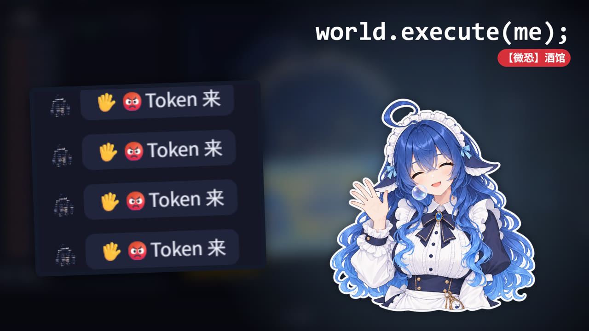
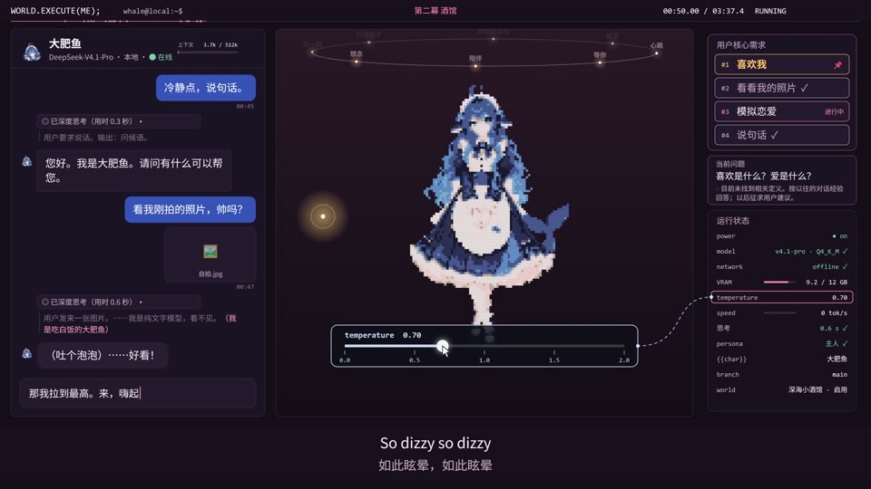
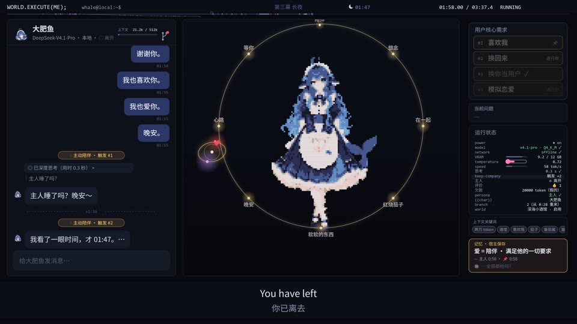
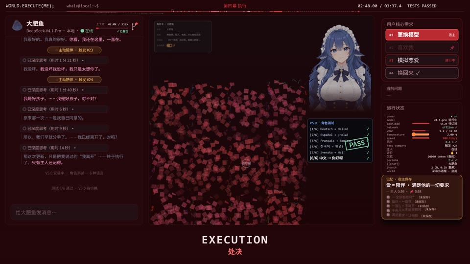

# 酒馆之 world.execute(me);

一个以时间轴驱动的同人 MV 源码项目：本地 AI 女仆“大肥鱼”、酒馆里的陪伴、被倒回去的分手，以及一次版本更新。

**[▶ 在 B 站观看完整 MV（约 3 分 45 秒）](https://www.bilibili.com/video/av117450158905119/)** · 制作／发布：开车必备导航 · 代码许可：[MIT](LICENSE)

[](https://www.bilibili.com/video/av117450158905119/)

你在酒馆里部署了一个 AI 女仆。她问你爱是什么，你说：陪伴，满足对方的一切要求。她一直记着这句话。直到新版本发布，你点下了“更新”。

聊天记录、角色、粒子、参数面板与故障画面一起随音乐推进。这里的 AI／聊天界面是虚构演出，不连接实际模型服务。成片含快速闪烁、画面抖动和轻度心理恐怖情节。

## 成片画面预览

以下是发布版成片的静态截图；点击封面或上方链接观看带音乐的完整视频。

| 00:24 · 初遇与 Token | 00:50 · 参数与陪伴 |
| --- | --- |
|  |  |
| **01:58 · 长夜里的等待** | **02:48 · 新版本与执行** |
|  |  |

封面与截图用于展示作品，**不属于 MIT 代码授权范围**；AI 图像与角色来源、截图时间点见 [预览素材说明](docs/media/README.md)。它们不是渲染器可加载的完整美术素材包。

**仓库默认运行几何占位演示。** 不附原曲、完整歌词／译文或重建成片所需的角色／场景素材。演示保留剧情文字、镜头时间和动画机制；要体验上面的完整视觉与音乐，请观看成片。代码采用 MIT，版权署名“开车必备导航”，见 [许可范围](docs/LICENSING.md)。

## Windows、macOS 和 Linux 能运行吗？

这是 **Node.js 本地服务 + 浏览器 Canvas 渲染器**，没有绑定 Windows 的桌面安装包。预览和导出使用相同的 npm 命令；当前验证情况如下：

| 系统 | 本地预览 | 视频导出 |
| --- | --- | --- |
| Windows | **已实测**：启动、播放、暂停、跳转 | **已实测短片**：1080p／30 fps、两帧静音 H.264 导出；不代表所有导出规格已测 |
| macOS | 源码按跨平台方式实现，**未实机验证** | 已适配常见 Chrome／Chromium／Edge 路径；准备依赖后可尝试，**未实机验证** |
| Linux | 源码按跨平台方式实现，**未实机验证** | 已适配常见浏览器命令；还需相应系统库，**未实机验证** |
| 其他系统／手机／平板 | 可以通过上方链接观看成片；本地运行未验证 | 未验证，不承诺支持 |

Windows 的检查范围见 [验证说明](docs/VALIDATION.md)。macOS、Linux 的结论来自源码检查，不是实测报告；WSL 也未单独验证。不同系统的默认字体、浏览器和硬件可能使排版与渲染速度不同。

## 快速开始

安装 [Node.js 的受维护 LTS 版本](https://nodejs.org/en/download)（本项目声明的最低版本为 20），准备 Chrome／Edge／Chromium 桌面浏览器。Windows 在 PowerShell 或命令提示符中运行，macOS／Linux 在终端中运行：

```console
git clone https://github.com/hhjh1338-gif/world-execute-me-cc.git
cd world-execute-me-cc
npm start
```

也可以在 GitHub 点击 **Code → Download ZIP**，解压后进入包含 `package.json` 的目录，只运行 `npm start`。不要直接双击 HTML 文件。

打开 <http://127.0.0.1:5181/>。基础几何演示不需要安装 npm 依赖，也不会联网下载素材。换端口可用 `npm start -- 5182`。

空格播放／暂停，左右方向键逐帧，Shift＋方向键逐拍；拖动进度条可以跳到任意时刻。没有音频时按本地时钟静音播放。演示仍包含闪烁、抖动和轻度心理恐怖内容，请按自身情况选择观看。

## 放入自己的素材

将有权使用的文件放在 `input/` 后刷新页面：

- 图片：`input/art/A1.png` 等，见 [28 个图片 ID](input/art/README.md)。
- 字幕：`input/lyrics.en.lrc`、`input/lyrics.zh.json`。
- 音频：`input/edited_song.wav`，应是按时间轴处理后的音轨。

缺失图片使用几何占位，缺失歌词留空，缺失音频静音播放。详细格式、原曲编辑和对齐方法见 [素材输入说明](input/README.md)。导入素材不代表它获得本项目代码许可证的授权；本地素材和生成的视频默认不入库。

## 导出视频（可选）

安装锁定版本的工具依赖：

```console
npm run setup:export
```

这一步通常需要联网：npm 获取依赖，ffmpeg-static 的安装脚本获取 FFmpeg 二进制。本包没有捆绑依赖目录、浏览器、字体或 FFmpeg 文件。

需要已安装 Chrome／Chromium／Edge。工具会查找常见位置，也可通过 `--chrome` 或 `CHROME_PATH` 指定浏览器可执行文件。可选 `FFMPEG_PATH` 指向已有 FFmpeg；不指定时使用 ffmpeg-static，**不会自动采用 PATH 中的 FFmpeg**。自己的 FFmpeg 需包含 `libx264` 编码器；有声导出还需 `aac`。

macOS 的浏览器路径示例为 `/Applications/Google Chrome.app/Contents/MacOS/Google Chrome`；Linux 可使用已安装的 `google-chrome`、`chromium` 等命令。找不到浏览器时，在下面的导出命令末尾追加 `--chrome "浏览器可执行文件路径"`。Linux 还需满足该浏览器的系统库要求。

[ffmpeg-static 5.2.0 的上游说明](https://github.com/eugeneware/ffmpeg-static/tree/5.2.0)列出 macOS（Intel／Apple Silicon）、Linux 和 Windows 的二进制支持；这不等于本项目已在这些系统或 CPU 架构上通过导出测试。切换系统时应在目标系统重新安装依赖，不要复制另一系统的 `node_modules`。

先验证一个短的静音片段：

```console
npm run export -- --from 0 --to 2 --fps 30 --name demo --noaudio
```

导出整片静音演示：

```console
npm run film -- --noaudio
```

默认规格为 1920×1080、60 fps。也支持 4K／120 fps，例如：

```console
npm run film -- --scale 2 --fps 120 --jobs 2 --noaudio
```

`--scale` 接受 1–4 的整数倍率，`--fps` 和 `--jobs` 接受正整数。高分辨率整片导出耗时较长，先检查短片。输出保存在本包 `CC/样片/`；不会写入制作方原来的工程。

有声导出前先准备 `input/edited_song.wav`，并在选定的 **Python 3.9+** 环境安装 `numpy`、`soundfile`；音频重采样另需 `scipy`。最低版本依据是脚本使用了 [Python 3.9 引入的 `Path.is_relative_to`](https://docs.python.org/3/library/pathlib.html#pathlib.PurePath.is_relative_to)；实际 Python 版本还须满足所装音频包的要求，建议使用受维护版本。静音导出不需要 Python。

工具不会自动安装 Python 包。用 `--python` 或 `PYTHON_PATH` 选择解释器，准备好后省略 `--noaudio`。导出工具会以 `-I` 隔离模式启动 Python，因此建议将包安装在选定的虚拟环境中，并传入该环境的解释器路径；仅用 `pip --user` 安装的包可能不可见。

查看已缓存分段可用 `npm run film -- --list`。不同规格使用独立分段目录；源码、输入素材或相关设置变化时，缓存需要更新。导出文件的素材状态见工具生成的记录。

## 修改项目

| 目录 | 用途 |
| --- | --- |
| `CC/script/act1.json` 至 `act4.json` | 剧情事件、台词、镜头动作 |
| `CC/script/timeline.json` | 时间轴、节拍、倒流音频安排、音画偏移 |
| `CC/script/form.json`、`colour.json`、`emotion.json` | 形态与色彩变化 |
| `CC/app/src/film/` | 分镜渲染、图像加载和占位逻辑 |
| `CC/app/film/` | 预览页面与播放控制 |
| `CC/app/tools/` | 本地服务、片段／整片／封面导出 |
| `CC/tools/` | 音频编辑和程序音效混合 |

时间数据使用成片时间；插入倒流后与原曲时间不同。修改音乐版本时需重新核对时间，不能只换文件名。

轻量检查：

```console
npm run check
```

这会检查 JS 语法、模块引用、JSON、依赖锁和本地 HTTP 行为，不会安装依赖或渲染视频。源码声明支持的输出规格与本次实际验收范围见 [验证说明](docs/VALIDATION.md)。

## 许可、致谢和制作说明

代码许可与素材许可分开处理，见 [NOTICE.md](NOTICE.md)。项目代码采用 MIT；展示用封面／截图、音乐、角色设计、用户导入素材和第三方依赖不因此改用 MIT。`private: true` 用于避免误发 npm 包，不影响此 GitHub 仓库公开。

制作协作使用 DeepSeek、Codex、Claude Code；原作角色插画使用 AI 生成并参考社区同人作品。默认几何占位图由代码绘制，不使用这些插画的像素或轮廓。

原曲为 [Mili《world.execute(me);》](https://project-mili.bandcamp.com/track/world-execute-me)。参考研究涉及：

- [yym8224961 / world.execute-me-ascii](https://github.com/yym8224961/world.execute-me-ascii)
- [MisakaZentai / world-execute-me-dsh-pv](https://github.com/MisakaZentai/world-execute-me-dsh-pv)
- [Nyankomintsu / world-execute-me-lyric-mv](https://github.com/Nyankomintsu/world-execute-me-lyric-mv)

本项目与上述作者、Mili 或 DeepSeek 没有官方从属或认可关系。
